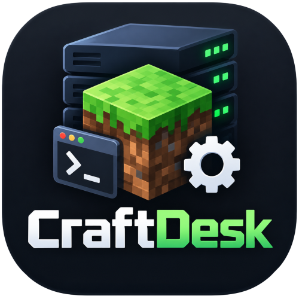

<div align="center">
  
  <h1>CraftDesk</h1>
  <p><b>Minecraft 多服务器管理器</b></p>
  <p>在一个窗口里管理你的所有 Minecraft 服务端：启停、看日志、装模组、管玩家、连跨服。</p>
  <p>此README由Deepseek V4.1 Flash总结</p>

[](https://www.electronjs.org/)
[](https://react.dev/)
[](https://www.typescriptlang.org/)
[](LICENSE)
[](#系统要求)

</div>

---

CraftDesk 是一个面向 Windows 的桌面端 Minecraft 服务端管理工具。它把开服过程中分散在
文件管理器、命令行和一堆配置文件里的事情收进同一个界面：导入或新建服务端、启动并盯着
日志、给服务器装模组和插件、管理玩家、维护跨服网络，以及备份存档。

面向的是「手上不止一台服」的场景 —— 主城、生存、小游戏、模组整合包，再加上一台
Velocity 或 BungeeCord 把玩家转进去。CraftDesk 会把它们的关系、状态和配置摊在同一个
窗口里，而不是让你在十几个文件夹之间来回切。

## 功能

### 服务器管理

- **统一列表**：左侧树状列出所有服务器。代理端作为入口挂在最上面，它的后端缩进排在下面，
  一眼能看出谁转发给谁；没被任何代理端引用的归到「独立服务器」。
- **主页通栏列表**：服务器名、核心类型、版本、端口、在线人数、PID、内存占用、已运行时长
  对齐在同一列上，服务器多了也好扫。
- **导入已有服务端**：选中目录即可，自动识别核心类型、Minecraft 版本、端口、MOTD、
  EULA 状态、世界存档大小；核心放在 `server/` 子目录、启动脚本是中文名也能认出来。
- **下载并新建**：Paper / Purpur / 原版 / Fabric / Forge / NeoForge，选版本一键安装。
  Forge 与 NeoForge 会自动下载官方安装器并跑完，装完直接在列表里可启动。
- **一键启停**：优雅停止（先发 `stop` 保存世界）、重启、异常退出自动重启、全部启动 / 全部停止。
- **运行状态**：实际监听端口、进程 PID、内存占用、在线人数、TPS、运行时长。
- **服务器图标**：可以换成表情、文字、底色或自己的图片。

### 控制台

- **实时日志**：按 INFO / WARN / ERROR / 聊天分级着色，支持关键字筛选、只看错误、自动贴底。
- **中文不乱码**：自动注入 UTF-8 参数，并对老版本 Java 做 UTF-8 / GBK 双解码回退。
- **直接发指令**：底部输入框发送服务器指令，`list` / `tps` / `save-all` 等常用指令一键发送。

### 模组与插件

- **四类分开**：MCDReforged 插件、代理端插件、服务端插件、模组互不混淆，各自显示启用状态。
- **单独禁用 / 启用**：改扩展名，文件留在原地；也可以直接删除单个文件。
- **前置关系**：每个扩展列出它依赖谁、谁依赖它。缺失的前置标红，被禁用的标橙，
  删除前提醒有几个扩展依赖它。点一下即可跳到对应的那个扩展。
- **是否在服务端有效**：读取模组声明的生效范围，纯客户端模组标「仅客户端」，
  只在服务端生效的标「仅服务端」，并给出汇总和筛选，方便清理多余模组。
- **关系星图**：以任意模组为中心画一张依赖星图，前置在左、依赖者在右，
  缺失的前置画成红点。可平移缩放，点节点换中心。
- **在线安装**：内置 Modrinth、Hangar、SpigotMC、CurseForge、MCDReforged 五个下载源，
  按当前服务器的版本与加载器过滤，服务端不支持的会标红提示。

### 跨服网络（Velocity / BungeeCord / Waterfall）

- **下载并生成配置**：直接下载代理端核心，并按你填的端口与描述生成它的配置文件
  （`velocity.toml` 或 `config.yml`），不用自己翻官网找 jar。
- **导入跨服网络**：选中代理端目录，CraftDesk 读出配置里的全部后端，在附近找回对应的
  服务器目录，列成清单让你勾选要导入哪些。
- **网络拓扑视图**：星图展示代理端与全部后端的连接、默认入口、运行状态与转发配置。
- **后端核对**：逐个检查后端是否真的接上了代理端。模组转发、Paper 原生转发、
  `spigot.yml` 的 BungeeCord 转发都认，密钥与在线模式一并核对；也会指出
  FabricProxy-Lite 只支持 Velocity、接 BungeeCord 时会把玩家踢掉这类问题。
- **配置编辑**：Velocity 的 `velocity.toml`、BungeeCord / Waterfall 的 `config.yml`
  都能直接在界面里改，注释原样保留。
- **一键添加后端**：从已导入的服务器里点选一台，自动填好名称与 `127.0.0.1:端口`；
  删除或重排后端时会同步维护 `priorities`，不会把代理端改到起不来。

### 世界地图

- **地表预览**：直接读服务端 `world/region` 的区块数据，把地表方块画成一张俯视图。
  草地、水、沙、树叶、建筑方块各有颜色，按高度做晕渲，山脊与河谷有立体感。
- **缩放与拖动**：滚轮以鼠标位置为中心缩放，拖动平移；鼠标指到的位置实时显示 X / Z / Y。
- **三个维度**：主世界、下界、末地分别切到存档里的 `region` / `DIM-1` / `DIM1`。
- **按需加载**：一个 region 渲染成一块图并缓存，只加载视口附近的区块；
  几百个 region 的大存档也能用，不会一次性把主进程卡住。
- **在线玩家位置**：地图上用玩家头像标出在线玩家的位置，每 4 秒刷新，
  旁边显示名字；切换维度时只显示当前维度的玩家。CraftDesk 启动的服务器直接
  通过控制台读取；外部启动的服务器需要开启 RCON。

### 配置与文件

- **`server.properties` 图形化编辑**：120 多项中文对照，布尔项开关、枚举项下拉，
  写回时保留原文件注释与顺序。
- **配置文件编辑**：MCDReforged 的配置与模组 / 服务端的配置分区显示，不会混在一起。
- **文件管理**：目录浏览、面包屑导航、内置文本编辑器（Ctrl+S 保存）、重命名、
  新建文件夹、删除到回收站、在资源管理器中打开。目录体积后台统计。
- **备份与还原**：一键整目录备份、列出既有备份、还原（还原前自动留一份兜底）。
- **安全的删除**：删除服务器分「只从列表移除」与「连目录一起删」两种，
  后者需要把服务器名字原样打对才执行，并且会先拦下磁盘根目录、用户主目录这类危险路径。

### 玩家

- 玩家列表显示在线状态、OP、白名单、封禁，一键切换（同时改 JSON 并向运行中的服务器发指令）。
- **玩家头像**：显示每个玩家的 Minecraft 头像；取不到时用首字母色块占位。
  头像缓存在本地，不会每次打开面板都重新下载。

### 界面

- 深色三栏布局：图标栏 / 服务器列表 / 主工作区 / 右侧面板，面板可折叠。
- **两侧栏宽度可调**：拖动分界线或用设置里的数值，双击恢复默认。
- **背景自定义**：换成自己的图片，并分别调整背景与面板的不透明度。
- 界面参照现代桌面应用的信息层级组织，长时间盯着日志也不累。

### 外置辅助端（MCDReforged）

- 新建服务器时可以顺手勾选 MCDReforged 托管：核心装进 `server/` 子目录，
  根目录留给 MCDR 自己的配置与 Python 插件，并自动选好对应的 handler。
- 建服前先验证 Python 环境（解释器、版本、`mcdreforged` 是否已装），
  缺哪一步就在界面里说明，并可以用 pip 直接装上。

## 系统要求

| 项 | 要求 |
|---|---|
| 操作系统 | Windows 10 / 11（64 位） |
| Java | 按服务端版本而定，CraftDesk 会自动扫描本机 Java 并推荐合适的版本 |
| Python | 仅在用 MCDReforged 托管时需要，3.8 及以上 |
| 磁盘占用 | 程序本体约 65 MB；服务器与备份另计 |

## 下载

在 [Releases](https://github.com/CZH223/CraftDesk/releases) 页面下载最新的
`CraftDesk-<版本>-portable.exe`。单文件、双击即用、不需要安装，也不申请管理员权限。

第一次运行会在 **exe 旁边**创建一个 `data` 目录，配置与服务器图标都在里面：

- 已经存在配置文件时直接读取，不会被默认值覆盖；
- 把整个文件夹拷到 U 盘或另一台电脑，服务器列表原样跟着走；
- 如果 exe 放在 `C:\Program Files` 这类没有写权限的位置，会自动改用
  `%APPDATA%\CraftDesk`，「设置 → 运行环境」里会写明当前用的是哪个位置。

也可以从源码构建，见下方「从源码构建」。

## 快速上手

1. 点左上角 **添加服务器**。已经有服务端目录就选「导入已有服务端」；
   想新开一台就选「下载并新建服务器」，选好版本一键装。
2. 在「服务器属性」里确认 Java 路径与内存大小，其余保持默认即可。
3. 点右上角 **启动**。首次启动如果服务端要求同意 EULA，界面上会出现提示条，点一下即可。
4. 启动完成后，底部输入框可以直接发送服务器指令，例如 `list`、`tps`、`whitelist add`。
5. 需要模组或插件时，打开左侧「下载扩展」，搜索后直接安装到当前服务器。

## 常见问题

**启动后立刻退出？**
多半是 Java 版本与服务端不匹配。控制台会打出 `UnsupportedClassVersionError`，
按提示换一个 Java 版本即可；「服务器属性」里可以单独指定这台服使用的 Java。

**提示端口被占用？**
到「服务器属性」里把 `server-port` 换成别的值，或者关掉占用该端口的程序。
CraftDesk 会在多个服务器配了同一个端口时标出来。

**控制台中文乱码？**
CraftDesk 已经自动尝试 UTF-8 与 GBK 两种解码。若仍然乱码，可以在 JVM 参数里加
`-Dfile.encoding=UTF-8`。

**模组列表是空的？**
点一下扩展面板右上角的刷新。如果仍然为空，检查「服务器属性 → 目录约定」里的
模组目录是否指向了正确的位置（默认会自动识别）。

**服务器不是 CraftDesk 启动的，能管吗？**
可以。CraftDesk 只读取日志与状态，不会去接管别的程序启动的进程。

## 从源码构建

```bash
npm install
npm run dev        # 开发模式（改代码自动重载）
npm run build      # 构建到 out/
npm run dist       # 打包成单文件便携版 exe
npm run dist:dir   # 只输出免安装目录，排查打包问题用
```

打包产物在 `release/` 下。如果换了应用图标，记得同步生成标题栏用的那张：

```bash
python scripts/make-logo.py build/icon.png src/renderer/public/logo.png 256
```

## 测试

```bash
npm test           # 离线测试（几秒到半分钟）
npm run test:all   # 连联网与耗时的重活一起跑
npm run app:test   # 起一个干净实例，用界面点着试（配置在 tmp/，不影响你的服务器列表）
```

测试覆盖扩展依赖解析、启动脚本生成、删除守门、跨服网络导入、界面尺寸与背景、
服务器图标、便携数据目录、代理端配置，以及若干联网下载源的真实抓取。

## 技术说明

每个功能背后的取舍、踩过的坑、以及验证到什么程度，都写在
[docs/技术说明.md](docs/技术说明.md) 里。

## 已知限制

- 仅支持 Windows；其他平台没有打包，也没有测试过。
- 暂停 / 继续服务端进程未实现（需要挂起整棵进程树，跨平台行为不一致）。
- 备份是整目录复制，没有增量与压缩，大世界会占用较多磁盘。
- Forge / NeoForge 的版本表只给每个 Minecraft 版本的推荐版与最新版，
  其他构建号需要手动填写。
- 代理端的插件与模组不会做版本过滤（代理端的版本号不是 Minecraft 版本号）。

## 许可证

[MIT](LICENSE)
